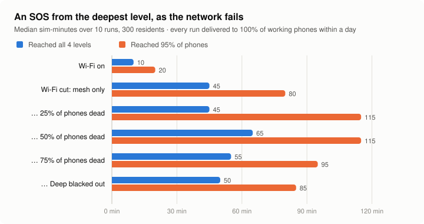
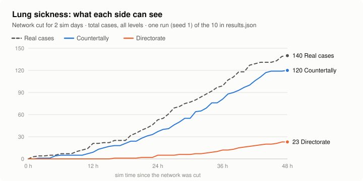
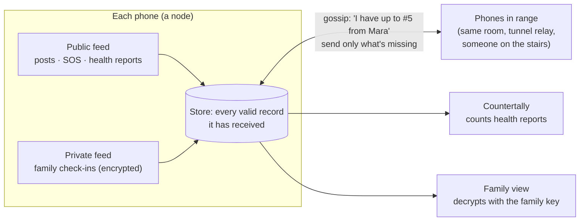

# Rat King

Patriot HackFest Fall 2026 · Track: **Life Underground**

The Directorate controls the Hollow's network, and it can switch it off. **Rat King** is a
peer-to-peer mesh that it can't switch off: every phone keeps a signed, append-only log
of what its owner says, and phones swap logs with whoever is in range: in the same room,
through a relay in a tunnel, or in the pocket of someone climbing the stairs. Messages
get through network cuts, blackouts and collapsed stairwells, and a relay that rewrites
a message gets caught, because the signature no longer matches.

On top of the mesh run the services people in the Hollow actually need:

* **SOS**: a call for help that reaches every level without the Directorate's network.
* **Countertally**: residents report lung-sickness symptoms; every phone can count the
  real outbreak itself and set it next to the Directorate's official number.
* **Family check-ins**: "I'm OK / hurt / need help / moving", encrypted so only your
  family can read it, even though every phone carries it.

> 🎬 **Video:** _link goes here_ · ▶️ **Run it:** `make venv && make demo` → http://localhost:8000

## Prompts we answer

| Prompt | How |
|---|---|
| **#7** The Directorate can shut the network down. How would people organize, share information or call for help without it? | The mesh itself: posts and SOS calls spread phone to phone, along tunnels and with people walking the stairwells. Measured below: 100% delivery with the Wi-Fi cut. |
| **#9** Lung sickness is spreading and the Directorate's numbers don't match what people see. | **Countertally**: signed health reports, counted on any phone, side by side with the official number, with stale levels marked instead of shown as zero. |
| **#8** During a blackout, families split across levels can't tell whether each other are okay. | **Family check-ins**: sealed with a shared family key, sent from a second identity that can't be linked to your public one. Check-ins jump when a level loses power. |
| #10 (partly) Medicine runs out in the deep levels first, and the clinic can be levels away. | An SOS of kind *medical* reaches a clinic on another level, even with the network down. |

One protocol, several services: adding a service means adding a record type and
something that reads it. Nothing in the mesh changes.

## Results

All numbers come from `make metrics`. It runs the real protocol (real signatures,
real verification, real gossip) over 10 seeds with 300 residents and writes
[`results.json`](results.json). The same seeds produce the same file, byte for byte.
The simulation decides only **who can reach whom** each tick; everything else is the
production protocol code. One tick is 10 sim-minutes.

<picture>
  <source media="(prefers-color-scheme: dark)" srcset="docs/img/delivery-dark.svg">
  
</picture>

| SOS from the Deep (medians) | Delivered within a day | All 4 levels | 95% of phones |
|---|---|---|---|
| Wi-Fi on | 100% | 10 min | 20 min |
| **Wi-Fi cut, mesh only** | **100%** | **45 min** | **90 min** |
| … and 25% of phones dead | 100% | 50 min | 95 min |
| … and 50% of phones dead | 100% | 70 min | 115 min |
| … and 75% of phones dead | 100% | 70 min | 110 min |
| … and the Deep blacked out | 100% | 50 min | 100 min |

With the network cut, an SOS still reaches every working phone. It takes about an hour
and a half instead of twenty minutes, because it travels through rooms, tunnels and
people carrying phones up the stairs. Even with three in four phones dead it gets through:
people walking between levels carry it.

<picture>
  <source media="(prefers-color-scheme: dark)" srcset="docs/img/outbreak-dark.svg">
  
</picture>

| Countertally, 2 sim days (means of 10 runs) | Share of real cases seen | First 10 cases seen after (median) |
|---|---|---|
| **Countertally**, network cut | **81%** | **8.5 h** |
| Directorate, network cut | 17% | 30.5 h |
| Countertally, Wi-Fi on | 80% | 7.5 h |
| Directorate, Wi-Fi on | 17% | 29 h |

| Attack | Result (10 runs) |
|---|---|
| **Split and heal**: Wi-Fi and every stairwell cut for 12 h while people keep posting | At the heal, phones held 81% of all records. **Every phone held every record 30 min later, in 10 out of 10 runs.** |
| **Lying relays** on every stairwell, rewriting what they carry | **7,011 altered copies sent, 0 accepted** by any phone; 787 records flagged as tampered |

**Read these honestly.**
* The Directorate's number is a model we chose: it learns of **25% of cases, 12 hours
  late**. It stands in for a slow, partial official count; it is not real data.
* Countertally sees about 80%, not 100%: in the sim, about 15% of sick households never
  file a report, and some reports are still on their way to the counting phone.
* Delivery depends on our walking model (each resident moves to a neighbouring room
  with 8% chance per tick). Real foot traffic would change the times, not the result.

## The demo

`make demo` starts the simulated Hollow with the locked demo seed and a scripted attack
sequence; `make sim` is free play. Open http://localhost:8000.

* **The map** is a cross-section of the Hollow: Gate, Homes, Farms and the Deep. Each
  level has fewer stairwells than the one above it, so the deeper you are, the harder
  you are to reach. The Deep has **one** service shaft; Farms is split in two by a
  collapsed tunnel.
* **Play the Directorate**: cut the Wi-Fi, cut power to a level (its Wi-Fi dies and only
  ~30% of phones stay on), click a stairwell to close it, or plant a lying relay.
* **Click anyone** to use their phone: post or send a colour to everyone, send an SOS,
  report symptoms, or check in with family. Dashed lines join them to their relatives.
  Each person is drawn in the colour of the newest beacon *their own* phone holds, so you
  can watch a message spread.
* **Countertally** (right panel): the Directorate's number and ours, level by level,
  counted on one phone (open any phone to count from it). Levels we haven't heard from
  recently are hatched and shown as "≥ N", never as zero.

The scripted run: the Wi-Fi goes down, the Deep's shaft is cut, and an SOS from the Deep
is stuck down there, along with the Deep's health reports (Countertally marks the level
"cut off"). When the shaft reopens, the SOS and the reports climb out level by level.
Then the Farms lose power, and later a lying relay appears on a stairwell and is caught
by the first phone that receives its forgery.

## How it works



* **Records.** Every message is a record in its author's feed:
  `{author, seq, prev, type, ts, payload}`, serialized as canonical JSON. Its id is the
  SHA-256 of those bytes, and it carries an **Ed25519 signature** from the author's key.
  `prev` is the previous record's id, so each feed is a hash chain.
* **Ingest.** A phone accepts a record only if the signature verifies, the payload
  matches its schema (strict Pydantic), and it extends the author's chain. Out-of-order
  records wait; a gap or a second record with the same seq (a fork) becomes evidence.
* **Gossip.** Two phones exchange version vectors ("highest seq I hold per author") and
  send each other what's missing. Syncing is a set union, so after any split everyone
  converges to the same data. There is no leader and no shared state, so there is no
  split-brain to resolve.
* **Tamper evidence.** A relay can change bytes in transit, but then the hash and the
  signature no longer match. The receiver rejects the record and raises an alert with
  the claimed and computed hashes.
* **Countertally** reads only records a phone already holds. It counts at most one report
  per household per day (spam damping), names a room only once 3+ households report
  from it (k-anonymity), flags hotspots with a Poisson test, and tracks how long since
  it last heard from each level, so missing data never reads as "0 cases".
* **Check-ins** are sealed with the family's shared key (XSalsa20-Poly1305) and published
  from a second key, so nothing links them to your public posts. There's no group tag:
  a phone simply tries each family key it holds.

### What's real and what's simulated

| Real (production code) | Simulated |
|---|---|
| Record format, hashing, Ed25519 signatures, chain checks, fork/gap/tamper evidence | Who can reach whom each tick (rooms, tunnels, stairwells, Wi-Fi, blackouts) |
| Gossip sync (version vectors, batching, push on publish) | Residents walking, and phones dying in a blackout |
| Payload schemas, Countertally, check-in encryption | The lung sickness, and the Directorate's official count |

All 300 phones run the real node code in one process, over an in-memory transport.
We don't build radios: real underground systems use relay nodes along tunnels plus
people carrying data, and the sim's links stand for those. The HTTP transport for real
laptops is designed but not built for this submission.

## Security: what we handle and what we don't

| Handled | How |
|---|---|
| Forged messages | Every record is signed by its author's key |
| Altered messages (lying relay) | Hash + signature mismatch → rejected, alert with evidence |
| Deleted or withheld messages | Hash chain: a missing seq is a visible gap |
| One key signing two histories | Fork evidence: both signed records are kept and flagged |
| Reading families' check-ins | Encrypted; relays only ever see ciphertext |
| Linking check-ins to a person's public posts | Separate key for the private feed |
| Report spam from one author | At most one counted report per author per day |

**Not solved yet** (we're upfront about it): fake accounts (one person, many keys),
stolen phones, and traffic analysis (someone watching who syncs with whom).

### Limits: isolation

A mesh needs *some* path between people. Rat King routes around cuts; it can't cross a
total one.

* **A sector the Directorate isolates completely** (every tunnel and stairwell closed,
  no Wi-Fi, nobody walking in or out) **falls out of date.** Its messages, SOS calls,
  health reports and check-ins wait on the phones inside. Nothing is lost: they spread
  the moment any link returns, even one person walking through. But until then, the
  rest of the Hollow doesn't know what's happening there.
* **An isolated person** (alone, with no one in range) is in the same position: their
  phone holds what they wrote, and it goes out only when someone comes within reach.
* What we do about it: we **show** the gap instead of hiding it. Countertally marks a
  level it hasn't heard from as "cut off, the real number is higher" and shows its count
  as "≥ N", never as zero; a family member's card shows how old their last check-in is.
  The silence itself is a signal that a place has been cut off.

Closing this gap needs a link the Directorate doesn't control: relays along the tunnels
or long-range radio (LoRa). That's on the roadmap, not in this build.

## Run it

Python 3.11+.

```sh
make venv          # one-time: creates .venv and installs everything
make demo          # live sim + dashboard, scripted demo → http://localhost:8000
make sim           # same, free play
make test          # 255 tests
make metrics       # results.json + the charts above (~1 min on 16 cores)
```

Without make: `python -m venv .venv`, activate it, `pip install -e ".[dev,http,sim]"`,
then `python -m hollowmesh.sim --script`, `python -m pytest`,
`python -m hollowmesh.sim.metrics && python -m hollowmesh.sim.plots`.

## Repo layout

| Path | What |
|---|---|
| `src/hollowmesh/protocol/` | Records, signing, node ingest, gossip sync, transports, payload schemas |
| `src/hollowmesh/services/` | Countertally and family check-ins |
| `src/hollowmesh/sim/` | The simulated Hollow: map, residents, sickness, Directorate attacks, live dashboard (`static/index.html`), metrics and charts |
| `spec/world.json` | The Hollow's floor plan |
| `tests/` | pytest suite |
| `results.json`, `docs/img/` | Measured results and the README charts (`make metrics`) |

(The Python package is still called `hollowmesh`, the project's working name.)

## Roadmap

* **Real transports**: HTTP between laptops, then Bluetooth / LoRa relays along tunnels.
* **Water reports** linked to recyclers, so an illness cluster points at the bad water
  upstream (prompt #4).
* **Signed surface readings**: a sensor at the Exit Tunnel whose air readings spread like
  any record, so a forged "the surface will kill you" gets caught (prompt #13).
* **Blackout early warning** from phones' outage reports (prompt #1).
* Sybil resistance (vouching), key revocation, compaction into signed checkpoints, and
  interest-based replication so a phone doesn't need everyone's records.

## Team

* **MK**: protocol (records, node, gossip), Countertally, check-ins, metrics.
* **Miguel**: the simulated Hollow and the live dashboard.

## AI tools

We used Claude Code (Anthropic) as a coding assistant. Every change was run and tested
by us before it was committed; the test suite and `make metrics` are how we checked it.
